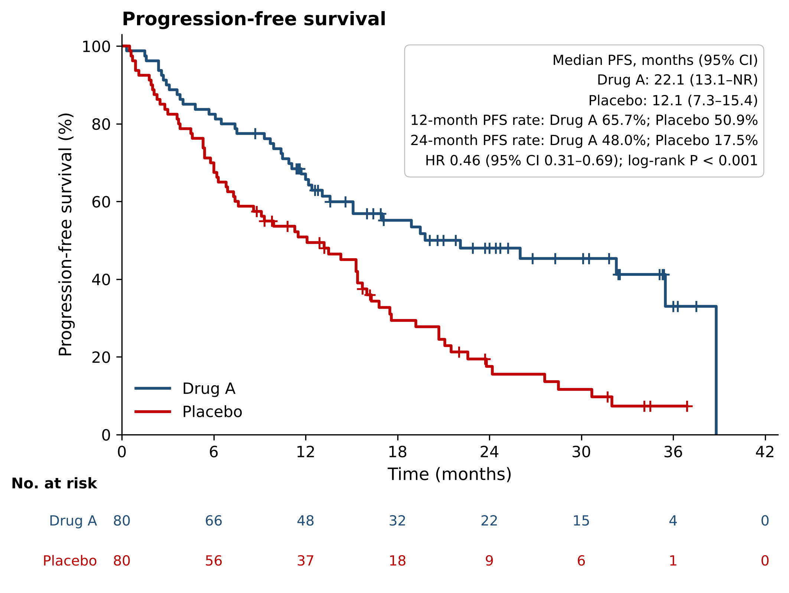
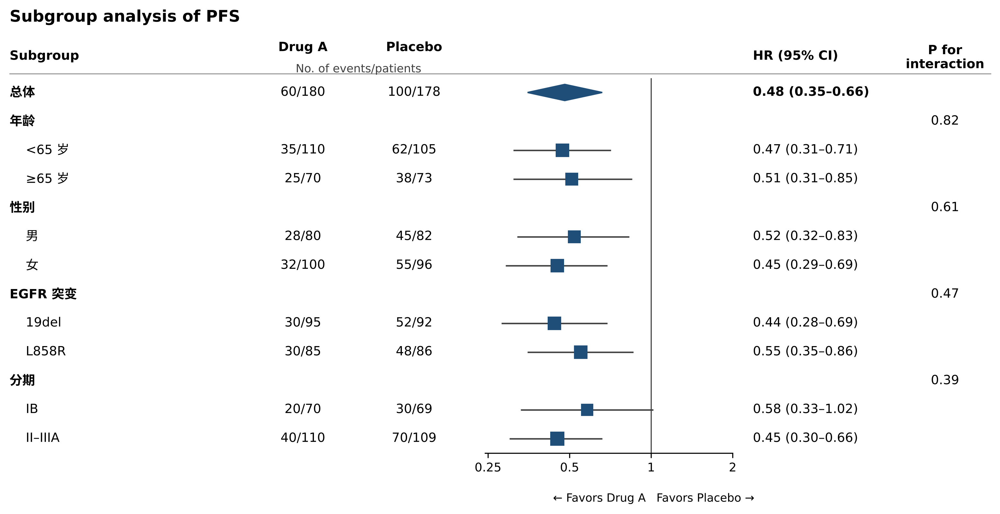
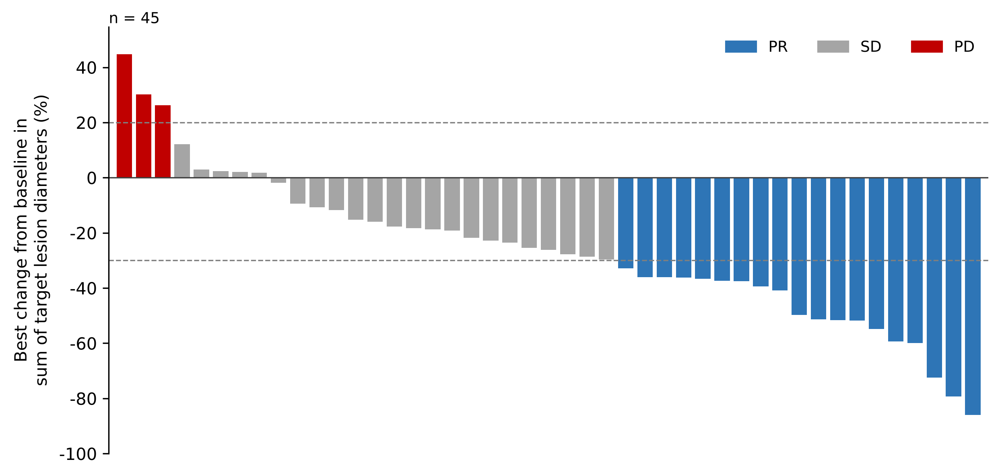
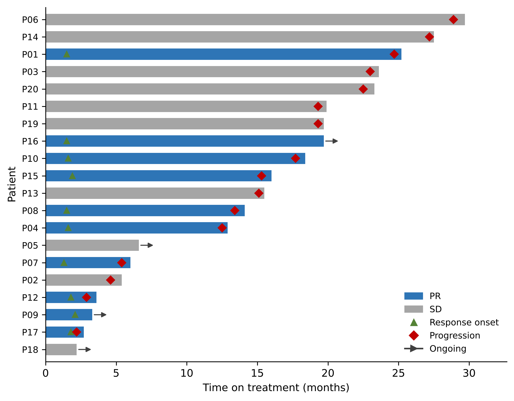

# msl-stat-figures：给 AI 助手用的医学统计图 Skill

用 AI 助手（WorkBuddy、Claude Code、Codex 等支持 `SKILL.md` 的 agent）画医学统计图：**KM 生存曲线、森林图、瀑布图、泳道图**。

这个 skill 是为医学部（MSL / MA）日常工作设计的，重点不在“画得快”，而在**不画错**：

- **先检查，后画图。** 数据有硬伤（HR 不在置信区间里、时间为负数、缺时间单位、表里有患者姓名）时，脚本拒绝出图；有可疑之处（例数、中位数、HR 与原文对不上，单位可疑，分组可能有不死时间偏倚）时，必须由使用者确认后才能出图。
- **AI 不写画图代码。** 统计计算和画图全部由自带脚本完成，能力一般的 agent 也只需按步骤跑几条命令。
- **不混用数字来源。** 一张图上的统计量要么全部来自原文，要么全部由数据计算，不会拼在一起。
- **每张图附核对单。** 列出图中每个数字的来源，计算值标注“AI 计算，待统计师复核”，并记录使用者确认过的问题和原话。

| KM 曲线 | 森林图 |
|---|---|
|  |  |
| **瀑布图** | **泳道图** |
|  |  |

*示例图均为虚构数据。*

## 能画什么

| 图 | 需要的数据 | 脚本做的计算 |
|---|---|---|
| KM 曲线 | 逐例数据：时间（或起止日期）、事件 1/0、组别 | KM 估计、中位数及 95% CI、指定时间点生存率、log-rank P、Cox HR、反向 KM 中位随访、风险人数表 |
| 森林图 | 每个亚组的 HR / OR / RR 及 95% CI（照抄原文），可选例数、事件数、交互 P | 不计算，只检查和画图 |
| 瀑布图 | 每例靶病灶最佳变化百分比、最佳疗效 | 不计算；按 RECIST 1.1 检查疗效与变化幅度是否矛盾 |
| 泳道图 | 每例治疗时长、是否仍在治疗、缓解 / 进展 / 死亡时间 | 不计算，只检查和画图 |

不画机制图、流程图、示意图；也不会照着论文或 PPT 里的图片“读数”重画。

## 统计结果经过验证

KM 和 Cox 部分的算法与 R 语言 `survival` 包的默认做法一致（置信区间方法可在 log-log 与 log 之间选择）。对 6 组模拟数据逐项比对了中位数及 95% CI、时间点生存率及 95% CI、log-rank 卡方、Cox 系数和标准误，共 94 项，精确到小数点后 5 位，全部一致。详见 [references/统计方法说明.md](references/统计方法说明.md)。

## 环境要求

- Python 3.8+，以及 numpy、pandas、matplotlib、openpyxl
- 不需要 R、SAS、lifelines 或 scipy
- 中文图需要系统里有中文字体（Windows 自带微软雅黑即可）

WorkBuddy 自带 Python 和上述库，Windows 电脑上无需另外安装。

## 安装

下载 [Release](../../releases) 里的 `msl-stat-figures-v*.zip`，解压后把 `msl-stat-figures` 文件夹放进你的 agent 的 skills 目录：

| Agent | 位置 |
|---|---|
| WorkBuddy（Windows） | `%USERPROFILE%\.workbuddy\skills\msl-stat-figures\`，或在“技能”面板导入，详见 [安装说明.md](安装说明.md) |
| Claude Code | `~/.claude/skills/msl-stat-figures/` |
| Codex | `~/.codex/skills/msl-stat-figures/`（或 `~/.agents/skills/`） |

也可以直接 `git clone` 到 skills 目录下。

装好后对 agent 说：“用 msl-stat-figures 把 examples 里的示例_KM曲线.xlsx 画成 KM 曲线”，能出图即说明安装成功。

## 工作流程

```
使用者提需求
  → agent 问清：数据来源、数据截止日期、终点定义、时间单位、对照组
  → import  把使用者的 Excel / CSV 按列名搬进模板（姓名、病历号等列自动不复制）
  → set / report  写入设置和原文报告值
  → check  检查：必须修改 / 需要确认 / 提示
  → 把问题原样发给使用者，等回复
  → draw --confirm "使用者原话"  出图：PNG（300 dpi）+ PDF（矢量）+ 核对单
```

脚本命令一览：

```
python scripts/statfig.py doctor                                   检查环境和字体
python scripts/statfig.py template KM 模板.xlsx                    生成空白模板（KM / 森林图 / 瀑布图 / 泳道图）
python scripts/statfig.py import KM 原表.xlsx 新文件.xlsx [--map "时间=OS月数"]
python scripts/statfig.py set 新文件.xlsx 时间单位=月 终点名称=OS
python scripts/statfig.py report 新文件.xlsx 组别=安慰剂 例数=60 中位时间=13.5
python scripts/statfig.py check 新文件.xlsx
python scripts/statfig.py draw 新文件.xlsx --confirm "使用者原话"
```

退出码：0 成功；2 有“必须修改”的问题；3 有“需要确认”的问题但没有 `--confirm`。

## 目录

```
SKILL.md                 给 AI 助手的操作说明（核心）
scripts/statfig.py       画图和统计脚本（单文件）
templates/               4 种图的空白 Excel 模板
examples/                示例数据（虚构）和出图结果
references/              统计方法说明、常见问题
安装说明.md               WorkBuddy 安装步骤
```

## 注意

- 图中标“AI 计算”的数字是由逐例数据算出的，对外使用前请统计师复核。
- 注册研究常用分层 Cox 模型，本工具计算不分层 HR；图上可以改用原文报告的 HR。
- 原文或 PPT 中已有的图，应直接使用原图并注明出处。
- 不同研究的数据不能画在一张图里比较（非头对头比较）。

## 许可

[MIT](LICENSE)
